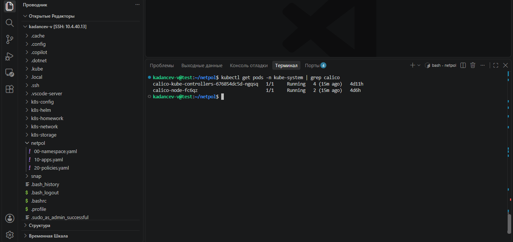
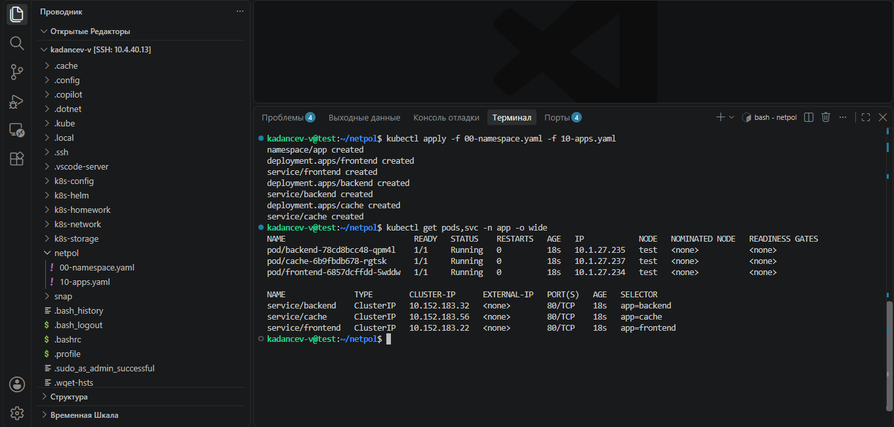
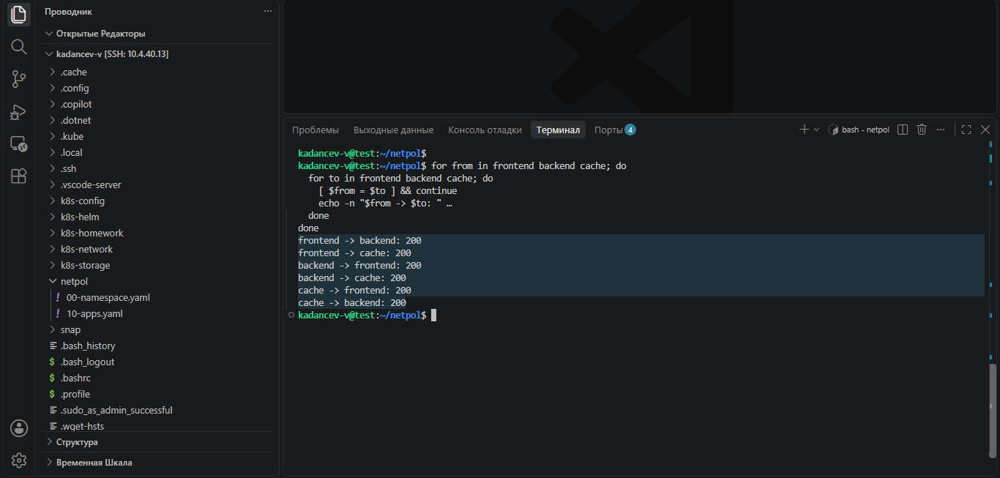
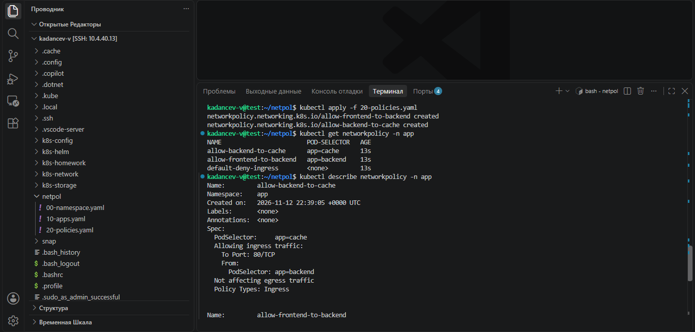
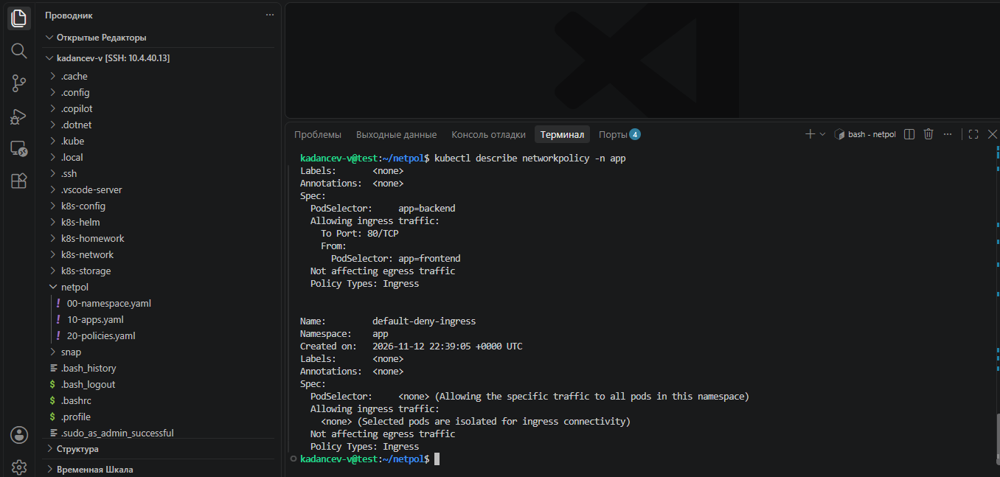
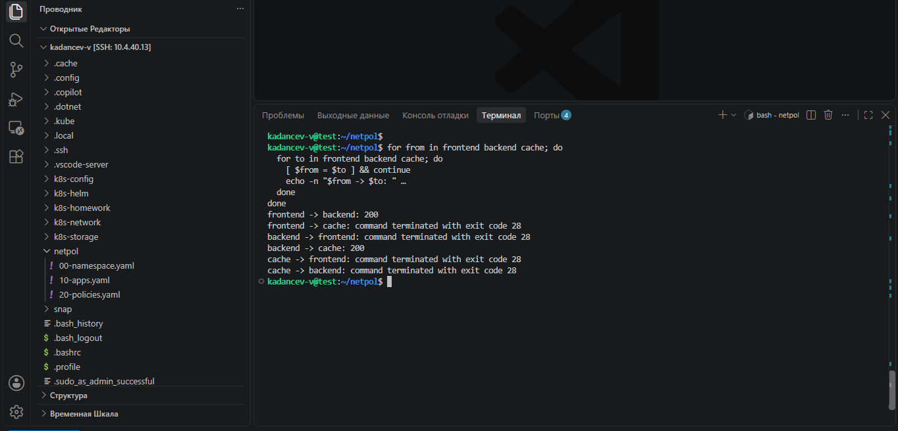
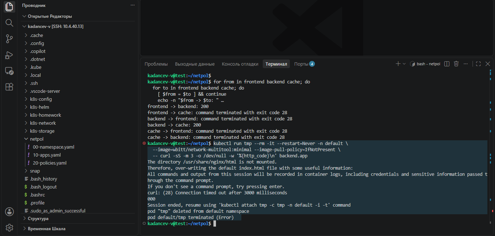

# Домашнее задание к занятию «Как работает сеть в K8s» - Kadancev Vladimir

### Цель задания

Настроить сетевую политику доступа к подам.

### Чеклист готовности к домашнему заданию

1. Кластер K8s с установленным сетевым плагином Calico.

### Инструменты и дополнительные материалы, которые пригодятся для выполнения задания

1. [Документация Calico](https://www.tigera.io/project-calico/).
2. [Network Policy](https://kubernetes.io/docs/concepts/services-networking/network-policies/).
3. [About Network Policy](https://docs.projectcalico.org/about/about-network-policy).

-----

### Задание 1. Создать сетевую политику или несколько политик для обеспечения доступа

1. Создать deployment'ы приложений frontend, backend и cache и соответсвующие сервисы.
2. В качестве образа использовать network-multitool.
3. Разместить поды в namespace App.
4. Создать политики, чтобы обеспечить доступ frontend -> backend -> cache. Другие виды подключений должны быть запрещены.
5. Продемонстрировать, что трафик разрешён и запрещён.

## Решение:

Манифесты лежат в каталоге `netpol/`:

- [00-namespace.yaml](): namespace `app`;
- [10-apps.yaml](): Deployment и Service для frontend, backend и cache;
- [20-policies.yaml](): сетевые политики.

Имя namespace `App` из условия записано строчными буквами (`app`): Kubernetes не допускает заглавных букв в именах namespace.

---

## Проверка: в кластере работает Calico

```bash
kubectl get pods -n kube-system | grep calico
```



Поды `calico-node` и `calico-kube-controllers` в статусе `Running`, значит NetworkPolicy в кластере будут применяться.

---

### Сетевые политики для доступа frontend → backend → cache

Namespace, Deployment'ы и Service'ы

Для каждого из приложений (frontend, backend, cache) создан Deployment с образом `wbitt/network-multitool:minimal` и Service типа ClusterIP на порт 80. Все объекты находятся в namespace `app`. Поды различаются меткой `app: frontend | backend | cache`.

```bash
kubectl apply -f 00-namespace.yaml -f 10-apps.yaml
kubectl get pods,svc -n app -o wide
```



### Доступ до применения политик

Из каждого пода выполняется запрос к двум остальным сервисам:

```bash
for from in frontend backend cache; do
  for to in frontend backend cache; do
    [ $from = $to ] && continue
    echo -n "$from -> $to: "
    kubectl exec -n app deploy/$from -- curl -sS -m 3 -o /dev/null -w '%{http_code}\n' $to 2>&1 | tail -1
  done
done
```



Без политик доступны все шесть направлений (ответ `200`): по умолчанию в Kubernetes любой под может обратиться к любому.

### Сетевые политики

Файл [20-policies.yaml]() содержит три политики:

1. `default-deny-ingress` запрещает весь входящий трафик ко всем подам namespace `app` (пустой `podSelector`, список `ingress` не задан).
2. `allow-frontend-to-backend` разрешает входящий трафик на поды `app=backend` только от подов `app=frontend` по порту 80/TCP.
3. `allow-backend-to-cache` разрешает входящий трафик на поды `app=cache` только от подов `app=backend` по порту 80/TCP.

```yaml
apiVersion: networking.k8s.io/v1
kind: NetworkPolicy
metadata:
  name: default-deny-ingress
  namespace: app
spec:
  podSelector: {}
  policyTypes:
  - Ingress
---
apiVersion: networking.k8s.io/v1
kind: NetworkPolicy
metadata:
  name: allow-frontend-to-backend
  namespace: app
spec:
  podSelector:
    matchLabels: {app: backend}
  policyTypes:
  - Ingress
  ingress:
  - from:
    - podSelector:
        matchLabels: {app: frontend}
    ports:
    - protocol: TCP
      port: 80
---
apiVersion: networking.k8s.io/v1
kind: NetworkPolicy
metadata:
  name: allow-backend-to-cache
  namespace: app
spec:
  podSelector:
    matchLabels: {app: cache}
  policyTypes:
  - Ingress
  ingress:
  - from:
    - podSelector:
        matchLabels: {app: backend}
    ports:
    - protocol: TCP
      port: 80
```

```bash
kubectl apply -f 20-policies.yaml
kubectl get networkpolicy -n app
kubectl describe networkpolicy -n app
```





Политики складываются: сначала всё закрыто `default-deny-ingress`, затем две разрешающие политики открывают только нужные звенья цепочки. Любое соединение между подами проходит через входящую политику пода-получателя, поэтому все остальные подключения запрещены.

### Демонстрация: трафик разрешён и запрещён

Тот же цикл проверки после применения политик:



| Направление | Результат | Комментарий |
|---|---|---|
| frontend → backend | `200` | разрешено политикой `allow-frontend-to-backend` |
| backend → cache | `200` | разрешено политикой `allow-backend-to-cache` |
| frontend → cache | `exit code 28` (таймаут) | запрещено |
| backend → frontend | `exit code 28` (таймаут) | запрещено |
| cache → frontend | `exit code 28` (таймаут) | запрещено |
| cache → backend | `exit code 28` (таймаут) | запрещено |

Код 28 означает, что curl не получил ответ за 3 секунды: пакеты отбрасываются.

Проверка доступа из другого namespace (временный под в `default` обращается к `backend.app`):

```bash
kubectl run tmp --rm -it --restart=Never -n default \
  --image=wbitt/network-multitool:minimal --image-pull-policy=IfNotPresent \
  -- curl -sS -m 3 -o /dev/null -w '%{http_code}\n' backend.app
```



Запрос завершился таймаутом (`Connection timed out`, код `000`): доступ из других namespace тоже закрыт. Сообщение `pod default/tmp terminated (Error)` в конце вывода ожидаемо: curl завершился с ошибкой, после чего временный под удалился.

### Правила приёма работы

1. Домашняя работа оформляется в своём Git-репозитории в файле README.md. Выполненное домашнее задание пришлите ссылкой на .md-файл в вашем репозитории.
2. Файл README.md должен содержать скриншоты вывода необходимых команд, а также скриншоты результатов.
3. Репозиторий должен содержать тексты манифестов или ссылки на них в файле README.md.
